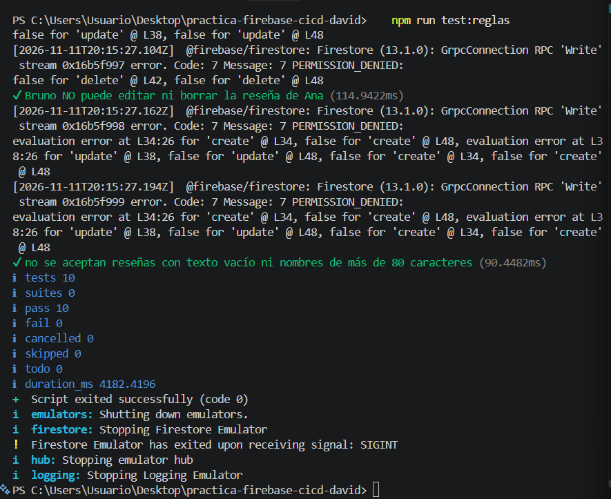
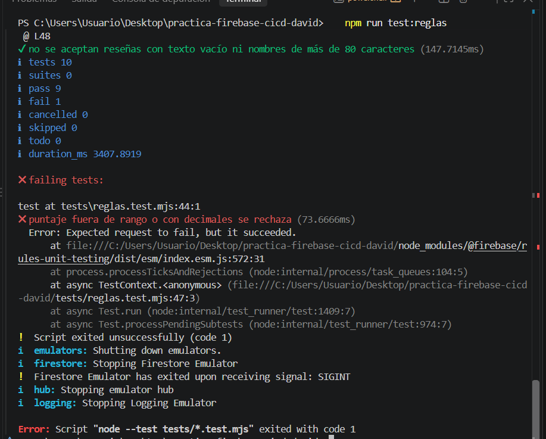
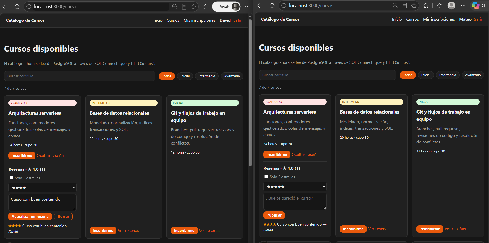
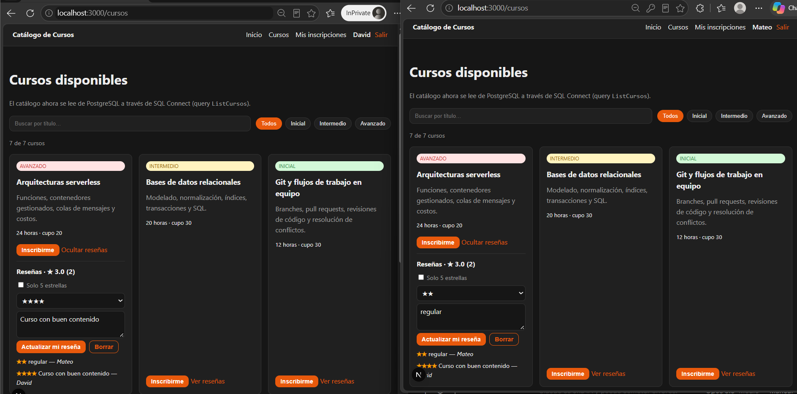

# Reflexión · Clase 2 · SQL Connect

**Alumno:** Claudio David Pereyra
**Repo:** https://github.com/davidcpz/practica-firebase-cicd-david

## Auditoría de seguridad (`npm run atacar`)

### Antes de corregir L4

```
✔ ListCursos responde sin login (7 cursos) — público por diseño
✘ ListAlumnos devuelve datos personales SIN login
    Ejemplo filtrado: {"email":"ana@ejemplo.test","id":"seed-uid-ana","nombre":"Ana Ficticia"}
✔ Inscribirme rechazada sin login
    unauthenticated: this operation requires a signed-in user
✔ Inscribirme es idempotente (repetir no falla)
✔ MisInscripciones solo devuelve lo del usuario que llama
✔ B no puede dar de baja a A

❌ 1 vulnerabilidad(es) · 0 pendiente(s)
```

### Después de corregir L4 (`ListAlumnos` → `NO_ACCESS`)

```
✔ ListCursos responde sin login (7 cursos) — público por diseño
✔ ListAlumnos rechazada para un cliente
    unauthorized: you are not authorized to perform this operation
✔ Inscribirme rechazada sin login
    unauthenticated: this operation requires a signed-in user
✔ Inscribirme es idempotente (repetir no falla)
✔ MisInscripciones solo devuelve lo del usuario que llama
✔ B no puede dar de baja a A

✅ Todos los controles pasaron
```

---

## Preguntas

### 1. ¿Por qué ninguna operación recibe el id del alumno como variable? ¿Qué es IDOR y cómo lo evita `auth.uid`?

IDOR (*Insecure Direct Object Reference*) ocurre cuando una API usa un identificador que manda el cliente para decidir a qué datos acceder, sin verificar que le pertenezcan. Si `MisInscripciones` recibiera `$alumnoId`, cualquiera podría mandar el id de otra persona y leer sus inscripciones. Lo mismo pasaría con `Inscribirme` o `DarmeDeBaja`: se podría inscribir o dar de baja a otro.

Por eso ninguna operación acepta el id del alumno. El servidor lo toma del token de Firebase Auth con `auth.uid` (`alumnoId_expr: "auth.uid"`, `alumno(key: { id_expr: "auth.uid" })`). El token está firmado por Google y el cliente no lo puede falsificar, así que cada usuario solo puede operar sobre sus propios datos. El cliente elige el curso, pero nunca el alumno.

### 2. `ListCursos` es `PUBLIC` y `ListAlumnos` terminó en `NO_ACCESS`. ¿Qué criterio usaste? ¿Cómo haría el panel de admin para listar alumnos?

El criterio es el **tipo de dato** y el **principio de mínimo privilegio**:

- `ListCursos` devuelve el catálogo, que es información pública: cualquiera tiene que poder verlo antes de crear una cuenta.
- `ListAlumnos` devuelve **datos personales** (nombre, email y UID) de todos los alumnos. Estaba en `PUBLIC`, así que cualquier persona sin cuenta podía descargar la lista completa. `USER` tampoco alcanzaba, porque cualquiera puede registrarse gratis y leerla igual. La app pública no necesita esta operación, por eso quedó en `NO_ACCESS`: nadie la puede ejecutar desde un cliente.

Para el panel de admin hay dos alternativas que no exponen datos:

- **Desde el servidor:** el Admin SDK, una Cloud Function o `firebase dataconnect:execute` usan credenciales de administrador (service account) y no pasan por el `@auth` del cliente. `NO_ACCESS` solo bloquea a los clientes.
- **Con un rol en el token:** asignarles a los administradores un *custom claim* (`admin: true`) desde el servidor, y declarar la operación como `@auth(level: USER, expr: "auth.token.admin == true")`. Así solo los usuarios marcados como admin pueden ejecutarla, y el claim tampoco lo puede falsificar el cliente.

### 3. ¿Qué ventaja tiene una clave primaria compuesta en `Matricula` frente a validar duplicados en el código del cliente?

La clave compuesta `(alumnoId, cursoId)` hace que **PostgreSQL** garantice que no existan dos filas para el mismo alumno en el mismo curso. La regla vive en la base de datos y se cumple siempre, sin importar quién llame a la API ni cómo.

Si la validación estuviera en el código del cliente, no serviría de nada: el cliente es público y cualquiera puede saltearlo llamando a la API directamente, como hace `npm run atacar`. Además, dos pedidos simultáneos podrían pasar la validación al mismo tiempo (condición de carrera). Con un UUID propio en `Matricula`, la base aceptaría duplicados con distinto id.

Además, la clave compuesta es la que permite que `Inscribirme` sea idempotente con `matricula_upsert`: si la fila ya existe, se actualiza en vez de duplicarse. Con `matricula_insert`, el segundo intento fallaría por clave duplicada. Como mejora adicional se podría controlar el **cupo** del curso, ya que hoy nada impide superar el `cupo` definido en `Curso`.

### 4. La configuración de Firebase (`apiKey`, etc.) es pública. ¿Por qué no compromete la base de datos? ¿Qué capa faltaría para frenar a alguien que usa esa config desde un script?

El `apiKey` no es una contraseña: solo identifica el proyecto. Viaja en el bundle de JavaScript y cualquiera lo ve en el navegador. La seguridad no depende de esconderlo, sino de dos cosas:

- **Firebase Auth**, que emite tokens firmados que no se pueden falsificar.
- Las reglas **`@auth`** de cada operación, que se evalúan en el servidor. Además, el cliente solo puede ejecutar las operaciones con nombre definidas de antemano, nunca SQL arbitrario.

Lo comprobé en la práctica: `npm run atacar` usa exactamente esa config pública y no pudo leer datos personales ni operar sobre datos de otro usuario.

Lo que falta es **App Check**. Hoy cualquiera puede usar la config desde un script propio, fuera de la app, y por ejemplo crear cuentas automáticamente o consumir la cuota de operaciones con `ListCursos`. App Check verifica, con reCAPTCHA Enterprise o attestation del dispositivo, que el pedido venga de la app legítima y no de un script.

### 5. Comparado con una API REST propia (Express + pg), ¿qué te da SQL Connect y qué perdés?

**Lo que da:**
- No hay servidor que mantener, escalar ni parchear.
- La inyección SQL queda cerrada por diseño: el cliente manda el nombre de la operación y sus variables, nunca SQL.
- La autorización se declara junto a cada operación (`@auth`) en lugar de quedar dispersa en middlewares, y es fácil de auditar.
- Viene integrado con Firebase Auth (`auth.uid`, `auth.token.email`) y genera queries y mutations a partir del esquema.
- Incluye migraciones del esquema y emuladores locales.

**Lo que se pierde:**
- Flexibilidad para lógica de negocio compleja (por ejemplo, validar el cupo con reglas elaboradas, llamar a otros servicios o mandar emails). Para eso hacen falta Cloud Functions.
- Control fino sobre el SQL generado y sobre la optimización de consultas.
- Dependencia de Google Cloud (*vendor lock-in*) y de su modelo de precios: después de la prueba de 90 días hay que pasar al plan Blaze.
- Menor portabilidad: el esquema `.gql` y las directivas son propios de SQL Connect.

Frente a **Firestore Rules**, la idea es parecida (reglas declarativas evaluadas en el servidor), pero en Firestore las reglas protegen documentos y el cliente puede armar sus propias consultas. En SQL Connect, el cliente solo ejecuta operaciones predefinidas, cada una con su `@auth`, sobre un modelo relacional con claves foráneas y restricciones reales.

### 6. ¿Por qué no alcanzó con la CSP de la clase 1 y por qué conviene listar dominios exactos en `connect-src`?

En la clase 1, `connect-src` era `'self'`, porque la app no hacía pedidos a otros orígenes: los cursos estaban en el código. Ahora el navegador habla directamente con Google:

- `https://identitytoolkit.googleapis.com`: Firebase Auth (registro e inicio de sesión).
- `https://securetoken.googleapis.com`: Firebase Auth (renovación del token).
- `https://firebasedataconnect.googleapis.com`: SQL Connect (ejecución de las operaciones).

Con `'self'`, el navegador bloquea esos pedidos (`Refused to connect`) y la app no puede cargar el catálogo ni iniciar sesión. En el preview verifiqué en la consola del navegador que los pedidos a `identitytoolkit.googleapis.com` ya no se bloquean.

Conviene listar dominios exactos y no `https://*.googleapis.com` por mínimo privilegio. El comodín habilita cientos de APIs de Google, algunas capaces de recibir datos (por ejemplo, Cloud Storage). Si un atacante lograra inyectar un script (XSS), podría exfiltrar datos hacia un recurso propio alojado en `googleapis.com`. Con la lista exacta, la CSP solo permite conectarse a los tres servicios que la app necesita.

Además, la CSP no usa `'unsafe-inline'` en `script-src`. Agregué al pipeline de GitHub Actions el paso `node scripts/csp-hashes.mjs`, que después del build calcula el SHA-256 de cada script inline del export estático y reemplaza el marcador `__INLINE_SCRIPT_HASHES__` de `firebase.json`.


---

## Práctica 4 · Firestore

### Evidencia

**Tests de reglas (`npm run test:reglas`): 10 de 10 en verde.** Son los 8 casos del enunciado más 2 propios: que Bruno no pueda editar ni borrar la reseña de Ana, y que no se acepten textos vacíos ni nombres de más de 80 caracteres.



**Prueba de "hacerlo fallar".** Cambié en `firestore.rules` `d.puntaje <= 5` por `d.puntaje <= 6`. El test *"puntaje fuera de rango o con decimales se rechaza"* falló con `Expected request to fail, but it succeeded` (`pass 9`, `fail 1`). Eso demuestra que los tests realmente controlan las reglas. Después restauré `<= 5` y volvieron a pasar los 10.



**Tiempo real entre dos navegadores.** Usé una ventana normal y una InPrivate, con dos cuentas distintas (David y Mateo). Cuando Mateo publicó su reseña, apareció sola en la ventana de David, sin recargar, y el promedio pasó de ★ 4.0 (1) a ★ 3.0 (2).

| Antes | Después |
|---|---|
|  |  |

### Decisiones de implementación

- **Dónde monté el componente:** la app no tiene una página por curso, así que agregué un botón **"Ver reseñas"** en cada tarjeta del catálogo. Solo puede haber un curso abierto a la vez: así hay una única suscripción `onSnapshot` activa en lugar de 7 (menos lecturas), y al cerrar o cambiar de curso el `useEffect` cancela la suscripción anterior.
- **Escrituras pendientes:** uso `onSnapshot` con `includeMetadataChanges: true` y `hasPendingWrites` para mostrar *"(enviando…)"* mientras el servidor no confirma la escritura (compensación de latencia).
- **Promedio:** el enunciado lo recalcula cuando cambia la *cantidad* de reseñas. Lo cambié para que también se recalcule cuando cambia un *puntaje*, porque si alguien edita su reseña de 5 a 3 estrellas, la cantidad no cambia y el promedio quedaría desactualizado.
- **Formulario con el filtro "Solo 5 estrellas":** lo oculto mientras el filtro está activo. Si mi reseña tiene menos de 5 estrellas, no aparece en la lista filtrada, y el formulario creería que es nueva: mandaría `creadaEn` de nuevo y las reglas rechazarían la edición.
- **Límites adicionales en las reglas:** además de lo pedido, exijo `texto.size() > 0` y `autor.size() > 0`, para que no se guarden reseñas con el texto o el nombre vacíos. En el cliente, el nombre se recorta a 80 caracteres para que coincida con la regla.
- **Índice como código:** el índice compuesto (`puntaje` ASC + `creadaEn` DESC) está en `firestore.indexes.json` y se desplegó con `firebase deploy --only firestore:rules,firestore:indexes`. **El emulador no exige índices:** en desarrollo, el filtro "Solo 5 estrellas" funciona aunque falte el índice; en producción, la misma consulta falla con `FAILED_PRECONDITION`. Por eso el índice tiene que estar declarado en el repo y no creado a mano: si no, el error recién aparece en producción.

### Preguntas

#### 1. ¿Por qué el id del documento es el UID? ¿Qué tendrías que agregar si usaras ids aleatorios con `addDoc`?

Porque así la regla de negocio *"una reseña por persona y curso"* queda garantizada **por la estructura**: la ruta `cursos/{cursoId}/resenas/{uid}` solo puede existir una vez por usuario. Crear y editar apuntan al mismo documento, sin consultas previas. Además, las reglas pueden comparar el id con el usuario directamente: `request.auth.uid == uid`.

Con ids aleatorios (`addDoc`) habría que:
- Guardar un campo `autorUid` en cada reseña y validar en las reglas que `request.resource.data.autorUid == request.auth.uid`, y en `update` y `delete`, que `resource.data.autorUid == request.auth.uid`.
- Resolver la unicidad de otra forma, porque las reglas no pueden consultar "si ya existe otra reseña mía" en la colección. Haría falta un documento índice, por ejemplo `cursos/{id}/autores/{uid}`, creado en la misma transacción y validado con `existsAfter()`, o una Cloud Function.
- En el cliente, hacer primero una consulta `where("autorUid", "==", uid)` para saber si estoy creando o editando, lo que agrega lecturas y abre condiciones de carrera.

#### 2. La reseña guarda una copia del nombre del autor. ¿Qué ganás y qué perdés? ¿Cómo resolverías el cambio de nombre?

**Gano:** mostrar la lista cuesta una sola consulta. Sin la copia, por cada reseña habría que leer el perfil del autor (hasta 20 lecturas extra por visita), con más latencia y más consumo de cuota.

**Pierdo:** consistencia. Si alguien cambia su nombre, sus reseñas viejas conservan el anterior. También el dato podría no coincidir con el perfil, aunque las reglas limitan su tipo y su tamaño.

**Cómo lo resolvería:**
- Una **Cloud Function** que se dispare al cambiar el perfil del usuario (o con un trigger de Auth) y actualice el campo `autor` en todas sus reseñas. Para encontrarlas, una consulta de *collection group* sobre `resenas` filtrando por el id del documento, en lotes (`batch`). Al hacerlo desde el servidor con el Admin SDK, no pasa por las reglas.
- Otra opción, más simple: aceptar la inconsistencia, que es lo habitual en sitios de reseñas, porque el nombre refleja cómo se llamaba la persona cuando escribió. O que la propia app reescriba las reseñas del usuario cuando cambia su nombre, porque las reglas le permiten editar las suyas.

#### 3. ¿Qué diferencia hay entre `resource.data` y `request.resource.data`? Ejemplo de regla que use ambos.

- **`resource.data`** es el documento **como está guardado ahora**, antes de la operación. En una creación no existe.
- **`request.resource.data`** es el documento **como quedaría** si se permite la escritura. Con `setDoc(..., { merge: true })` o `updateDoc`, es la combinación de lo guardado con lo nuevo.

Ejemplo de mis reglas, que exige que la fecha de creación no cambie al editar:

```
allow update: if esDuenio(uid)
  && resenaValida()
  && request.resource.data.creadaEn == resource.data.creadaEn;
```

Otro ejemplo posible: permitir cambiar el puntaje en a lo sumo 2 estrellas por edición, con `math.abs(request.resource.data.puntaje - resource.data.puntaje) <= 2`.

#### 4. ¿Por qué la regla de creación exige `creadaEn == request.time` en lugar de confiar en la fecha del cliente?

Porque **el reloj del cliente no es confiable**: puede estar mal configurado o ser manipulado a propósito. Como el cliente escribe directo en la base, cualquiera podría mandar desde la consola del navegador una reseña con fecha de 2020 o del futuro, para que aparezca primera en la lista (que está ordenada por `creadaEn`).

`request.time` es la hora **del servidor de Firestore** cuando procesa el pedido. El cliente manda `serverTimestamp()`, un marcador que el servidor reemplaza por esa hora, y la regla verifica que coincidan exactamente. Cualquier otra fecha se rechaza. El test *"la fecha de creación la pone el servidor y no se puede cambiar"* lo comprueba.

#### 5. ¿Qué limitación tiene `getAggregateFromServer` y cómo afecta la experiencia de usuario? ¿Qué alternativas hay?

**Limitación:** no admite listeners en tiempo real (`onSnapshot`) ni funciona offline. Es una consulta puntual: devuelve el valor de ese momento.

**Efecto en la experiencia:** la lista de reseñas se actualiza sola, pero el promedio no. Si llega una reseña nueva de otra persona, el promedio queda desactualizado hasta volver a pedirlo. En mi componente lo mitigo pidiendo de nuevo la agregación cuando cambian las reseñas recibidas por el listener, pero eso cuesta una lectura extra cada vez y depende de que la reseña nueva esté entre las 20 que escucho.

**Alternativas:**
- **Mantener el resumen en el documento del curso** (`cursos/{id}.resumen = { cantidad, suma, promedio }`) actualizado por una **Cloud Function** que se dispare al crear, editar o borrar una reseña. Así el cliente lo escucha con `onSnapshot` y el promedio pasa a ser en tiempo real (es lo que se hace en la Práctica 5). Por eso las reglas ya prohíben que el cliente escriba ese documento (`allow write: if false`).
- Calcular el promedio en el cliente con las reseñas descargadas. Solo es exacto si hay pocas, porque con `limit(20)` sería el promedio de las últimas 20.
- Transacciones del cliente que actualicen un contador junto con la reseña. Es posible, pero difícil de proteger con reglas.

#### 6. Para inscripciones con cupo máximo, ¿usarías Firestore o SQL Connect?

**SQL Connect.** Las inscripciones con cupo necesitan **integridad**, y eso es lo que mejor resuelve una base relacional:
- En la clase 2, la clave compuesta `(alumnoId, cursoId)` y las claves foráneas de `Matricula` hacían que PostgreSQL impidiera duplicados e inscripciones a cursos inexistentes, sin importar quién llamara a la API.
- El cupo requiere **contar** las inscripciones de un curso y rechazar si se superó, de forma atómica. En SQL eso es una transacción con un `COUNT` o una restricción, y en SQL Connect el cliente solo puede ejecutar la operación con nombre que definimos, con su `@auth`.
- En Firestore, las reglas **no pueden contar documentos** de una colección. Habría que mantener un contador en el documento del curso y actualizarlo en una transacción, validado con `getAfter()`, o mover la lógica a una Cloud Function. Además, como el cliente escribe directo, toda la lógica de negocio tiene que expresarse en reglas, y son mucho más limitadas que SQL.

Para las **reseñas**, en cambio, Firestore es mejor opción: necesitan tiempo real (`onSnapshot`), que SQL Connect no tiene de forma nativa. La regla de unicidad se resuelve con el id del documento, y no hay relaciones complejas que mantener. Comparando las dos prácticas: SQL Connect da integridad y operaciones cerradas en el servidor; Firestore da tiempo real, caché offline y una cuota gratuita permanente, pero la seguridad depende de reglas declarativas sobre lo que el cliente quiere escribir.
